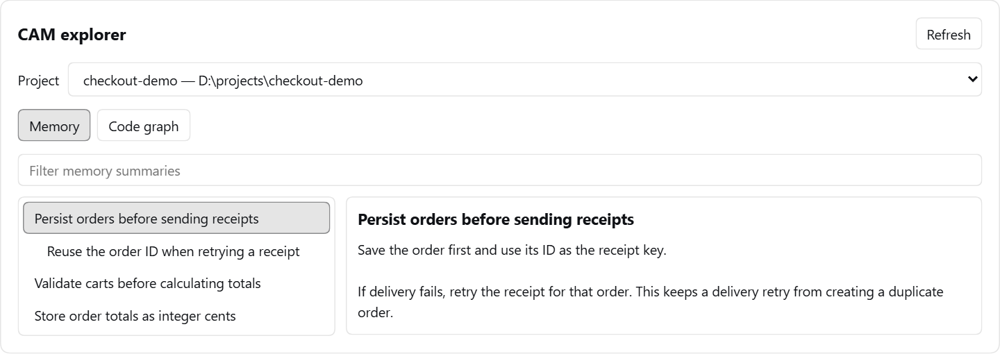
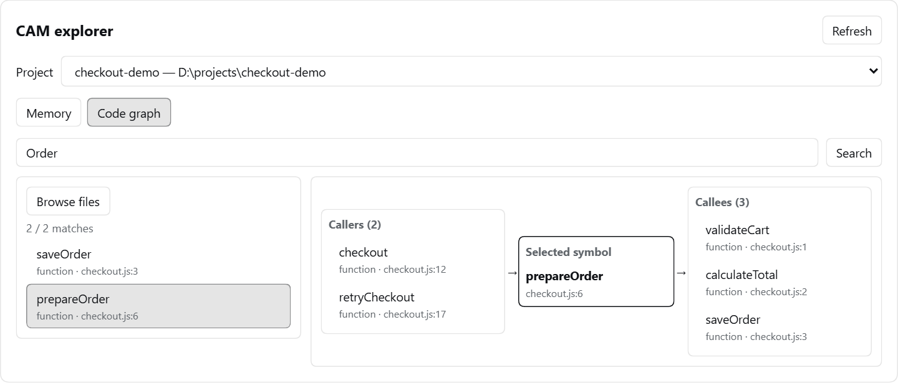

# dsh-cam-plugin

[English](README.md) · [中文](README.zh.md) · [日本語](README.ja.md) · [한국어](README.ko.md) · [العربية](README.ar.md)

Connect local [cam](https://github.com/HanochZhu/codeagent_memory) (code agent memory: a project's code graph and solution memory) to [DeepSeek Harness](https://github.com/deepseek-ai/deepseek-harness) (DSH, DeepSeek's agent runtime).

The plugin talks to the local `cam --json` binary. The memory and code graph stay in the target project's `.cam/cam.db` and are not uploaded.

## Interface preview

**Memory browser**



**Code graph**



## Prerequisite

`cam` is already on `PATH` and `cam --help` runs. This package does not ship the binary.

## Install

```sh
dsh plugin --profile <profile> add github:HanochZhu/dsh-cam-plugin
```

The entry point is plain ESM, so install does not run a build script. Start Harness with that profile:

```sh
dsh --profile <profile>
```

`--dump-config` lists a layer named `# == dsh-cam-plugin`.

## Explore a project

In Harness Web, open **Plugins → Installed → dsh-cam-plugin** and select a project in **CAM explorer**.

- **Memory** shows the project's memory tree. Filter by summary and select an entry to read its body and follow related memories.
- **Code graph** lets you browse indexed files or search by symbol. Select a symbol to inspect its one-hop callers and callees, then select a neighbor to follow the graph.

The explorer uses the configured `project` or `CAM_PROJECT` as its first choice, followed by the workspaces registered in Harness. If a project has no code graph, run `cam index` in the project root and refresh the explorer.

## Configure

To pin the binary or the default project, override this row by id in the profile's `cordis.patch.yml`. That layer replaces the row's entire `config`:

```yaml
- id: cam
  config:
    camBin: cam
    project: D:/work/my-repo
```

`project` can be omitted. Every tool accepts `path`. When both are omitted, cam uses `CAM_PROJECT`, then walks up from the process working directory looking for `.cam` or `.git`.

To try a checkout that is not installed as a bundle:

```sh
dsh web --patch ./cordis.example.yml
```

The plugin path in `cordis.example.yml` must be absolute.

## Tools

| Tool | Role |
| --- | --- |
| `cam_recall` | Search solution memory with one English sentence |
| `cam_index` | Build the graph once, then update it incrementally |
| `cam_ls` / `cam_find` / `cam_grep` | List a directory, find by symbol name, or search literal text |
| `cam_read` / `cam_ref` | Read one symbol, or list callers (`in`) and callees (`out`) |
| `cam_add` / `cam_mem_show` / `cam_mem_tree` | Store one memory, show it by id, or print the memory tree |
| `cam_status` | Show the resolved project and database |

When Harness provides the skill service, the plugin registers a runtime skill named `cam`. Its steps match these tools.

## Development

```sh
npm test
```
