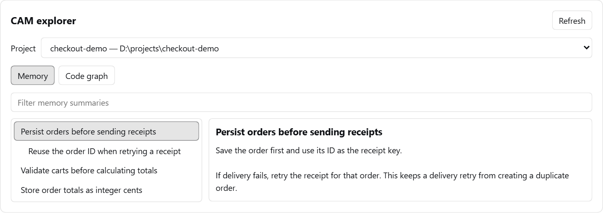
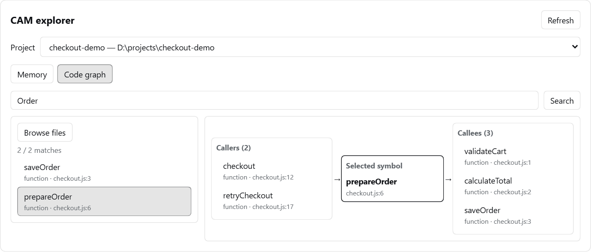

# dsh-cam-plugin

[English](README.md) · [中文](README.zh.md) · [日本語](README.ja.md) · [한국어](README.ko.md) · [العربية](README.ar.md)

把本地 [cam](https://github.com/HanochZhu/codeagent_memory)（code agent memory，项目里的代码图 + 解法记忆）接到 [DeepSeek Harness](https://github.com/deepseek-ai/deepseek-harness)（DSH，DeepSeek 的 agent 运行时）。

插件通过本机 `cam --json` 工作。记忆和代码图留在目标项目的 `.cam/cam.db`，不会上传。

## 界面预览

**记忆浏览**



**代码图**



## 准备

`cam` 已经在 `PATH` 上，`cam --help` 能跑。本包不附带这个二进制。

## 安装

```sh
dsh plugin --profile <profile> add github:HanochZhu/dsh-cam-plugin
```

入口是纯 ESM，安装时不用执行构建脚本。装好后用这个 profile 启动：

```sh
dsh --profile <profile>
```

用 `--dump-config` 时，层列表里会出现 `# == dsh-cam-plugin`。

## 浏览项目

在 Harness Web 打开 **插件 → 已安装 → dsh-cam-plugin**，然后在 **CAM 项目浏览**中选择项目。

- **记忆**展示项目的记忆树。可以按摘要筛选，点击条目查看正文和关联记忆。
- **代码图**支持浏览已索引的文件和搜索符号。点击符号可查看一跳调用方和被调用方，再点击任意邻居继续查看。

项目列表优先显示配置中的 `project` 或 `CAM_PROJECT`，随后列出 Harness 已注册的工作区。若项目还没有代码图，在项目根目录运行 `cam index` 后刷新面板。

## 配置

指定二进制或默认项目时，在 profile 的 `cordis.patch.yml` 里按 id 覆盖。这一层会换掉该行的整个 `config`：

```yaml
- id: cam
  config:
    camBin: cam
    project: D:/work/my-repo
```

`project` 也可以不写。每个工具都有 `path`；都不写时，cam 用 `CAM_PROJECT`，再从进程工作目录向上找 `.cam` 或 `.git`。

未安装成 bundle、只想本地试跑时：

```sh
dsh web --patch ./cordis.example.yml
```

`cordis.example.yml` 里的插件路径必须是绝对路径。

## 工具

| 工具 | 作用 |
| --- | --- |
| `cam_recall` | 用一句英语检索解法记忆 |
| `cam_index` | 首次建图，之后只做增量 |
| `cam_ls` / `cam_find` / `cam_grep` | 列目录、按符号名查找、按字面文本搜索 |
| `cam_read` / `cam_ref` | 读一个符号，或看调用方（`in`）和被调用方（`out`） |
| `cam_add` / `cam_mem_show` / `cam_mem_tree` | 写入一条记忆、按 id 查看、打印记忆树 |
| `cam_status` | 看解析到的项目和数据库 |

Harness 有 skill 服务时，插件会注册运行时 skill `cam`，步骤和上面这组工具一致。

## 开发

```sh
npm test
```
